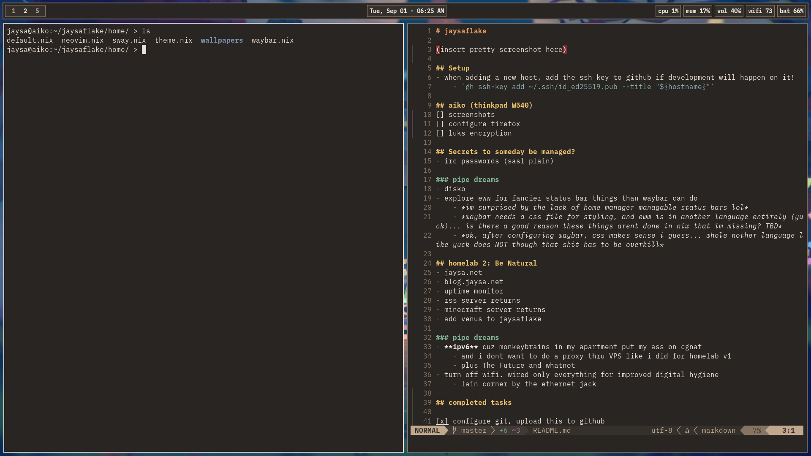

# jaysaflake



## Adding New Hosts

1. `git clone https://github.com/jaysa68/jaysaflake.git ~/jaysaflake`
2. 

- add the ssh key to github if development will happen on it!
    - `gh ssh-key add ~/.ssh/id_ed25519.pub --title "${hostname}"`

To run a host as a VM: ```nixos-rebuild build-vm --flake .#venus ./result/bin/run-venus-vm```

## homelab 2: Be Natural

- nikki: OCF staff vm
    - TODO rename to tiffany (cuz university lol)
- momo: hetzner VM
- kyu: gaming PC turned to archlinux host
- celeste: google cloud VM (TO BE DECOMMISSIONED)
- tiffany: unifi express 7 router
    - TODO rename to inna_de_poona

### portable devices
- venus: framework 13
- audrey: thinkpad X220T
- aiko: thinkpad W540
- nikki: steam deck

### arini
- abia: nixOS VM running 24/7 on a macbook pro

## TODO

## jaysa.net
[ ] easily listen to billboard top 100 / spotify top 50
[ ] expand emoticons page to also have emotes; add search
[ ] self-hosted pastebin for uploading imgs to irc
- [ ] manage momo with jaysaflake
    - [ ] uptime monitor (on friend's homelab?)
    - [ ] jaysa.net
    - [ ] blog.jaysa.net
    - [ ] minecraft server returns
    - [ ] rss server returns
        - WBE
        - aella
        - ppl from college

## home manager
[x] screenshots
[x] configure firefox
[ ] add microphone toggle and status in status bar, next to mute

## misc
[ ] easy way to add songs to ipod shuffle
[ ] backup yubikey setup
[ ] tui spotify listen-along client
    - requires spotify token from my acct
    - maybe make a repo for this proj (until they inevitably take it down)
    - ncmpcpp plugin?
    - i had this before but lost in the rebirth of venus

- decommission nikki

### neovim
[ ] sql/postgres queries in a file of another language should still have sql syntax highlighting? yeah, should be smthn out there for this

### Secrets to someday be managed?
- irc passwords (sasl plain)

### pipe dreams
- disko
- explore eww for fancier status bar things than waybar can do
    - *im surprised by the lack of home manager managable status bars lol*
    - *waybar needs a css file for styling, and eww is in another language entirely (yuck)... is there a good reason these things arent done in nix that im missing? TBD*
    - *ok, after configuring waybar, css makes sense i guess... whole nother language like yuck does NOT though that shit has to be overkill*
- backup ipod shuffle?

### pipe dreams
- **ipv6** cuz monkeybrains in my apartment put my ass on cgnat
    - and i dont want to do a proxy thru VPS like i did for homelab v1
    - plus The Future and whatnot
- turn off wifi. wired only everything for improved digital hygiene
    - lain corner by the ethernet jack

## completed tasks

[x] configure git, upload this to github
[x] add venus to jaysaflake
